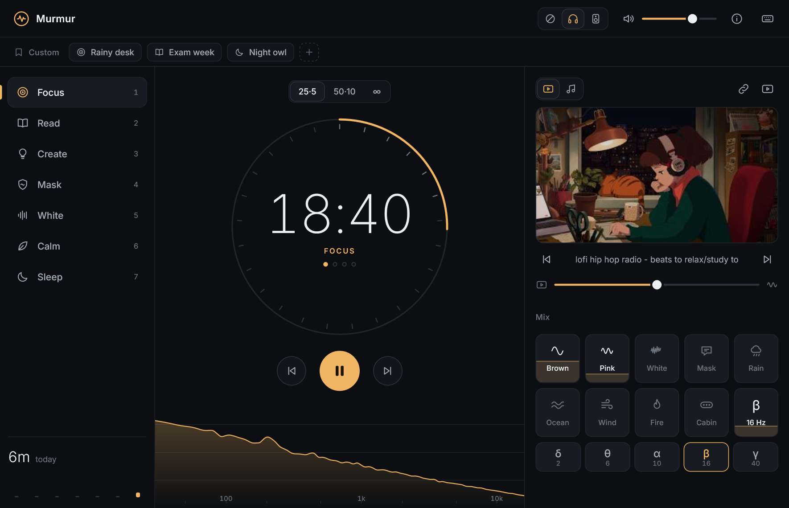
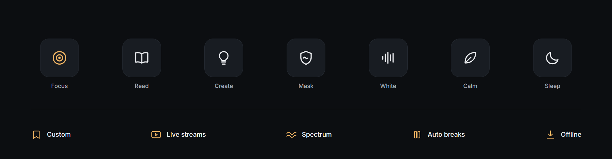
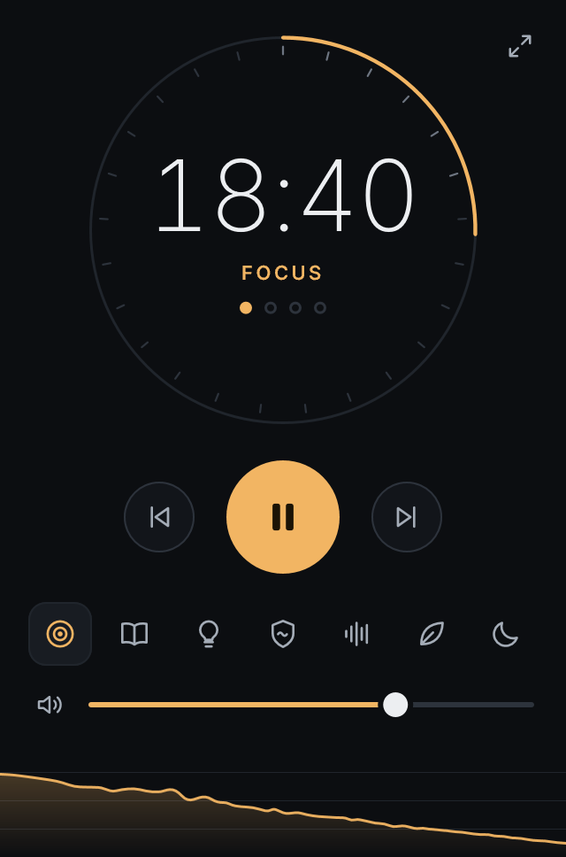
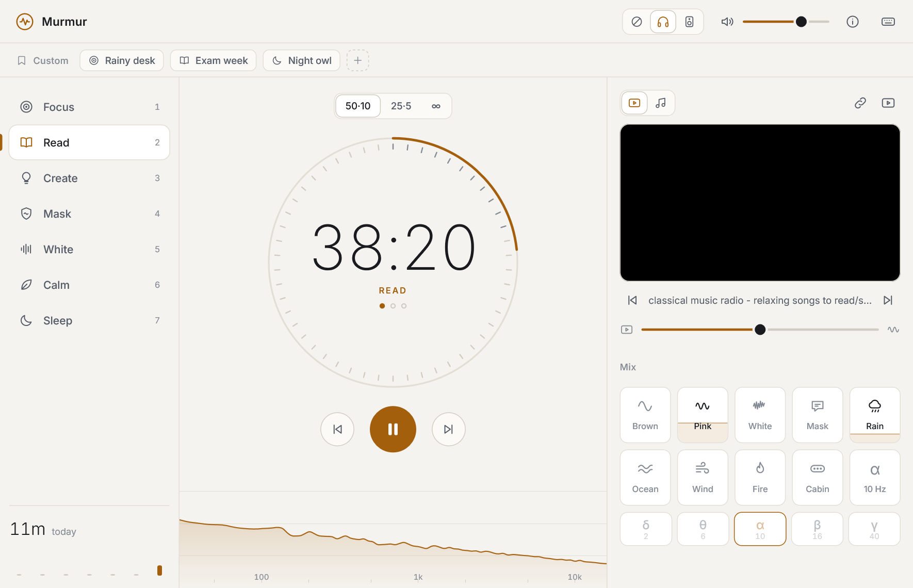
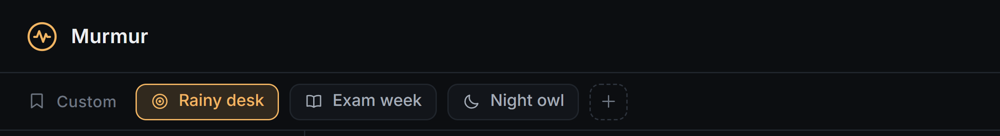

<h1 align="center">Murmur</h1>
<p align="center">Focus sounds that run themselves.</p>
<p align="center"><a href="#windows-app"><b>Windows app</b></a> &nbsp;&middot;&nbsp; <a href="https://goodly58.github.io/murmur/">Web ⭐</a> &nbsp;&middot;&nbsp; <a href="#run-locally">Run locally</a></p>

<p align="center"></p>

<p align="center"></p>

## Windows app

Native, with no browser and no runtime. The program is 1.3 MB and uses under 25 MB of memory and under 1% of a core while it plays.

**[Download Murmur.exe](https://github.com/Goodly58/murmur/releases/latest/download/Murmur.exe)** and run it to start. To add it to the Start menu, run this once in the folder you saved it in:

```
Murmur.exe --install
```

Then press the Windows key and type **Murmur**. `--uninstall` removes it again.

It isn't code-signed yet, so Windows may show a SmartScreen warning the first time: choose **More info**, then **Run anyway**. The [releases page](https://github.com/Goodly58/murmur/releases) also lists `Murmur.exe.sha256`, to check the download against.

<details>
<summary>Build it yourself</summary>

<br>

With MinGW-w64 installed:

```
native\build.cmd
native\bin\Murmur.exe --install
```

</details>

<p align="center">&nbsp;&nbsp;&nbsp;</p>

- **N** shrinks it to a mini player that stays on top while you work.
- **Right-click the taskbar icon** for one-click sessions, like Sprint 15 · 3.
- **Hover the taskbar icon** for previous, play and next.
- **Unplug the headphones** and it pauses instead of moving to the speakers.

<details>
<summary>Start a session from a shortcut</summary>

<br>

Add these after `Murmur.exe` (it lives in `%LOCALAPPDATA%\Programs\Murmur`), in a desktop shortcut's Target box or in a terminal:

| Add | What it does |
|---|---|
| `--scene sleep` | Picks the scene: `focus` `sprint` `read` `create` `mask` `white` `calm` `sleep` |
| `--plan t60` | Picks the timing: `p25` 25·5, `p50` 50·10, `p15` 15·3, `t10` `t20` `t30` `t60` `t90` minute timers, `free` no timer |
| `--play` | Starts playing straight away |
| `--mini` or `--full` | Opens the mini player or the full window |
| a YouTube link or music files | Plays them instead of the scene's stream |

For example, a 60 minute sleep timer that starts by itself:

```
Murmur.exe --scene sleep --plan t60 --play
```

</details>

Live streams and your own music play through [mpv](https://mpv.io) and yt-dlp. If they're missing, the player shows **Set up streaming**, which fetches both in one click with no admin rights. The sounds need neither.

<details>
<summary>How streaming setup works</summary>

<br>

One click downloads both from their official GitHub releases (about 50 MB) into `%LOCALAPPDATA%\Murmur\tools`, and `--uninstall` removes them again. Murmur keeps that yt-dlp up to date, since YouTube changes often. Already have them on PATH or in `C:\mpv`? Murmur uses those and leaves them alone.

</details>

## Web app

<p align="center"><a href="https://goodly58.github.io/murmur/"></a></p>

**[Open the web app](https://goodly58.github.io/murmur/)** in Chrome or Edge and use the install icon in the address bar. After the first visit it works offline.

## Run locally

Double-click `Start Murmur.bat`.

<details>
<summary>Under the hood</summary>

<br>

#### Windows app

Written in C++17 on Win32, Direct2D and WASAPI, and built with MinGW-w64. Every sound is synthesised once into a looping stereo buffer on a worker thread and freed 30 s after it stops. Audio goes straight to WASAPI in shared mode, the window repaints only the region that changed, the spectrum timer sleeps when the picture settles, and mpv is a separate process that exists only while a stream or a file plays.

| File | What it does |
|---|---|
| `audio.cpp` `dsp.cpp` | mixer, beats, chimes, WASAPI; the sound synthesis |
| `session.cpp` `model.cpp` `app.cpp` | plans and timing, saved state and presets, the controller |
| `ui.cpp` `ui_paint.cpp` `gfx.cpp` | layout and input, drawing, icons from the web sprite |
| `window.cpp` `jumplist.cpp` | window, mini player, timers, drag and drop, taskbar buttons, jump list, single instance |
| `stream.cpp` `resolver.cpp` | mpv over a pipe; finds live streams for each scene daily |
| `setup.cpp` | the Set up streaming button: downloads mpv and yt-dlp, checks their SHA-256, unpacks them, keeps yt-dlp updated |
| `install.cpp` | per-user install and Start menu entry |
| `version.h` | the version number; `mingw32-make APP_VERSION=1.2.3` sets it |
| `crash.cpp` | when the program dies on an exception, writes a note (what, where, the calls) to `%APPDATA%\Murmur\crash.log` |
| `thread.cpp` | threads straight from the Windows API, because the toolchain's `std::thread` crashed now and then on a busy machine |

`Murmur.exe --selftest` runs more than 400 checks (audio levels, scheduling, presets, hit-testing, rendered pixels). `--snapshot out.png --do presets --do spectrum` draws the real UI offscreen.

#### Builds and releases

- Every push is built with a pinned MinGW and checked on Windows Server 2022 and 2025 (`.github/workflows/windows.yml`): the self-tests of the dev build and of the release exe, and an offscreen draw of the window.
- To make a release, push a tag such as `v1.2.3`. Once the checks pass, `Murmur.exe` is attached to a GitHub release with its SHA-256, and the version is stamped into the exe. A tag with a suffix, like `v1.2.3-rc1`, makes a prerelease.

#### Web app

Each sound is synthesised once into a looping stereo buffer in a worker, so playback is `BufferSource -> Gain` with no per-sample JavaScript. The audio context sleeps when nothing plays, the YouTube player only exists while a video is wanted, and the spectrum repaints only while the mix changes.

| File | What it does |
|---|---|
| `index.html` `style.css` | layout, icons, themes |
| `ui.js` | scenes, ring, mix tiles, custom presets, media panel |
| `engine.js` `dsp.js` `worker.js` | audio graph and sound synthesis |
| `session.js` | plans, phases, timing |
| `video.js` | YouTube wrapper, skips dead streams |
| `spectrum.js` | live spectrum |
| `data.js` | sounds, plans, scenes, stream ids |
| `sw.js` `manifest.webmanifest` | install and offline |

- `py -3.13 tools/check_streams.py` lists which stream ids are still live.
- `node tools/calibrate.js` re-measures the sound loops after a renderer change.

</details>
