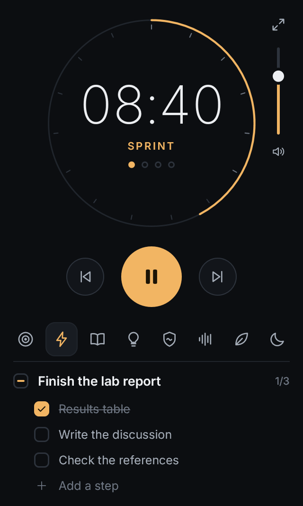

<h1 align="center">Murmur</h1>

Focus sounds that run themselves.

<a href="https://github.com/Goodly58/murmur/releases/latest/download/Murmur.exe"><b>Download for Windows</b></a> &nbsp;&middot;&nbsp; <a href="https://goodly58.github.io/murmur/">Web app ⭐</a>

&nbsp;&nbsp;&nbsp;

## Windows

Run `Murmur.exe`. To add it to the Start menu: `Murmur.exe --install`

2.3 MB, under 25 MB of memory, under 1% of a core. Not code-signed yet, so on the SmartScreen warning choose **More info**, then **Run anyway**.

Press `?` in the app for the keys.

## Web

[goodly58.github.io/murmur](https://goodly58.github.io/murmur/) installs from the address bar and works offline.

## More

[Guide](docs/guide.md) &nbsp;&middot;&nbsp; [Spotify](docs/spotify.md) &nbsp;&middot;&nbsp; [Plugins](docs/plugins.md) &nbsp;&middot;&nbsp; [Development](docs/development.md) &nbsp;&middot;&nbsp; [Privacy](docs/privacy.md) &nbsp;&middot;&nbsp; [MIT license](LICENSE)
