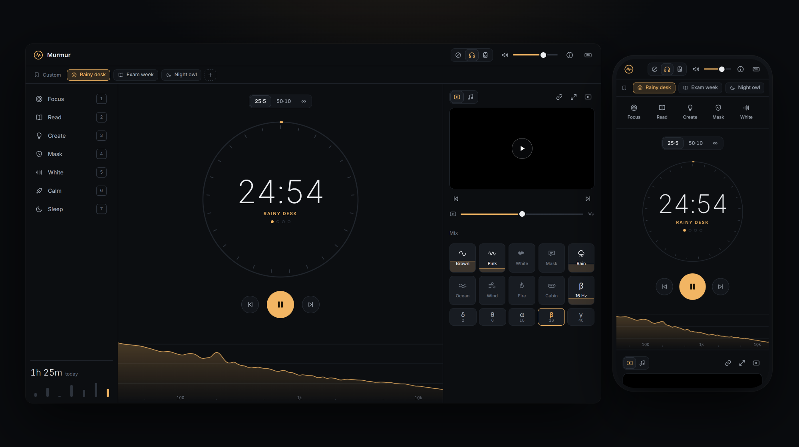
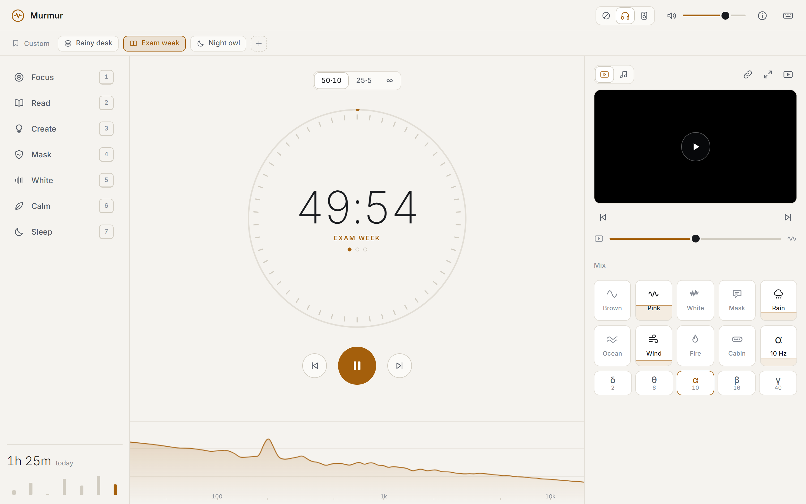
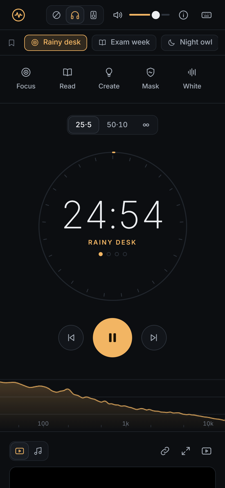

<h1 align="center">Murmur</h1>

Focus sounds that run themselves.

<a href="https://goodly58.github.io/murmur/"><b>Open</b></a> &nbsp;&middot;&nbsp; <a href="#install">Install</a> &nbsp;&middot;&nbsp; <a href="#run-locally">Run locally</a>

&nbsp;&nbsp;

### Install

Chrome or Edge: the install icon in the address bar. After the first visit it works offline.

### Run locally

Double-click `Start Murmur.bat`.

Under the hood

 

Each sound is synthesised once into a looping stereo buffer in a worker and freed 30 s after it stops, so playback is `BufferSource -> Gain` with no per-sample JavaScript. The audio context sleeps when nothing plays, the YouTube player only exists while a video is wanted, and the spectrum repaints only while the mix changes.

| | |
|---|---|
| `index.html` `style.css` | layout, icons, themes |
| `ui.js` | scenes, ring, mix tiles, custom presets, media panel |
| `engine.js` `dsp.js` `worker.js` | audio graph and sound synthesis |
| `session.js` | plans, phases, timing |
| `video.js` | YouTube wrapper, skips dead streams |
| `spectrum.js` | live spectrum |
| `data.js` | sounds, plans, scenes, stream ids |
| `sw.js` `manifest.webmanifest` | install and offline |

`py -3.13 tools/check_streams.py` lists which stream ids are still live. `node tools/calibrate.js` re-measures the sound loops after a renderer change.

