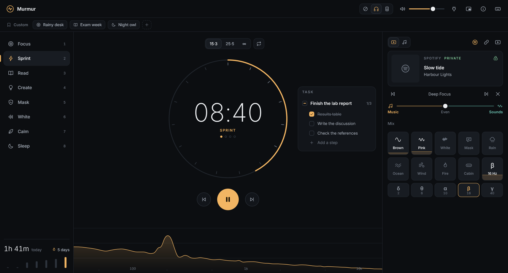
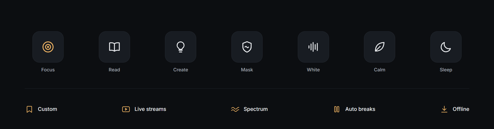
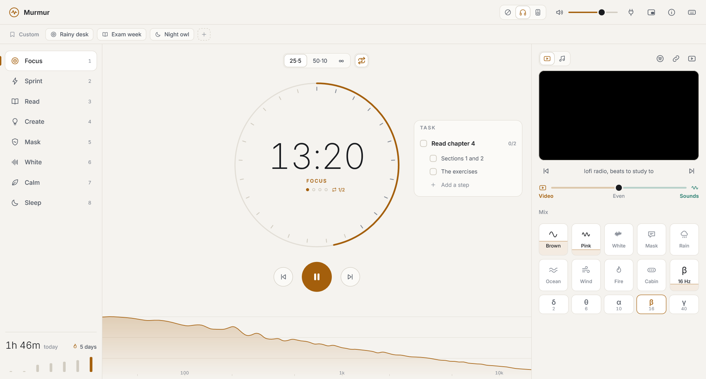
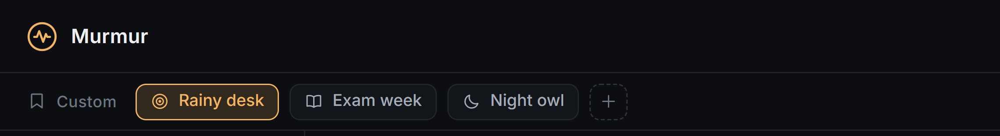

<h1 align="center">Murmur</h1>
<p align="center">Focus sounds that run themselves.</p>
<p align="center"><a href="#windows-app"><b>Windows app</b></a> &nbsp;&middot;&nbsp; <a href="https://goodly58.github.io/murmur/">Web ⭐</a> &nbsp;&middot;&nbsp; <a href="#run-locally">Run locally</a></p>

<p align="center"></p>

<p align="center"></p>

## Windows app

Native, with no browser and no runtime. The program is 2.3 MB and uses under 25 MB of memory and under 1% of a core while it plays.

**[Download Murmur.exe](https://github.com/Goodly58/murmur/releases/latest/download/Murmur.exe)** and run it to start. To add it to the Start menu, run this once in the folder you saved it in:

```
Murmur.exe --install
```

It asks before it adds anything (a script can add `--quiet` to skip the question). Then press the Windows key and type **Murmur**. `--uninstall` removes it again.

It isn't code-signed yet, so Windows may show a SmartScreen warning the first time: choose **More info**, then **Run anyway**. The [releases page](https://github.com/Goodly58/murmur/releases) also lists `Murmur.exe.sha256`, to check the download against.

<details>
<summary>Build it yourself</summary>

<br>

With MinGW-w64 installed:

```
native\build.cmd
native\bin\Murmur.exe --install
```

</details>

<p align="center">&nbsp;&nbsp;&nbsp;</p>

- **T** writes your task: one task for the whole plan, all its rounds together, with up to four steps under it if you want them. It sits in a card beside the ring, or behind the checklist button next to the plans in a narrower window. Tick things off as you go; a finished task clears when the plan starts again, and one that isn't finished waits for you.
- **R** loops the rounds, so Focus goes round again after the last one instead of stopping. The loop button beside the plans (it appears when the plan has timed rounds, like 25·5) opens a small chooser for how many sets to run, from 1 to 6 or until you stop it, and tells you how long that comes to. R switches it on and off with the number you picked.
- **When a plan ends** the ring says Done and offers **Start again**; Space or the big button does the same.
- **S** gives the scene a Spotify playlist in place of its live stream: pick one of yours from the list, type to find it, or paste a link. Each scene keeps its own. It plays privately, so Spotify doesn't record it or learn from it ([how](#spotify-playlists)).
- **Copy a YouTube or Spotify link** and Murmur offers to play it the next time you switch to it. Ctrl+V or dropping the link on the window works too.
- **Close it mid-round** (or restart the PC, or update Murmur) and it opens where you were, paused at the same round and minute, if you're back within half an hour.
- **A break starts while you're in another window** and the taskbar button lights up; days in a row with focus on them are counted beside today's time.
- **The plug button** lists your plugins: other programs that follow your rounds and breaks. Murmur comes with none; see [Plugins](#plugins).
- **N** shrinks it to a mini player that stays on top while you work: the clock, and under it your task and its steps, to tick off and edit right there. It is only as tall as the task needs, and the volume is a thin slider under the expand button.
- **Right-click the taskbar icon** for one-click sessions, like Sprint 15 · 3.
- **Hover the taskbar icon** for previous, play and next.
- **Unplug the headphones** and it pauses instead of moving to the speakers.

<details>
<summary>Start a session from a shortcut</summary>

<br>

Add these after `Murmur.exe` (it lives in `%LOCALAPPDATA%\Programs\Murmur`), in a desktop shortcut's Target box or in a terminal:

| Add | What it does |
|---|---|
| `--scene sleep` | Picks the scene: `focus` `sprint` `read` `create` `mask` `white` `calm` `sleep` |
| `--plan t60` | Picks the timing: `p25` 25·5, `p50` 50·10, `p15` 15·3, `t10` `t20` `t30` `t60` `t90` minute timers, `free` no timer |
| `--play` | Starts playing straight away |
| `--loop`, `--loop=4` or `--no-loop` | Loops the rounds until you stop it, for that many sets, or turns it off (it applies to `p25`, `p50` and `p15`) |
| `--mini` or `--full` | Opens the mini player or the full window |
| a YouTube link or music files | Plays them instead of the scene's stream |
| a Spotify playlist link | Makes it that scene's playlist and plays it |

For example, a 60 minute sleep timer that starts by itself:

```
Murmur.exe --scene sleep --plan t60 --play
```

</details>

Live streams and your own music play through [mpv](https://mpv.io) and yt-dlp. If they're missing, the player shows **Set up streaming**, which fetches both in one click with no admin rights. The sounds need neither.

<details>
<summary>How streaming setup works</summary>

<br>

One click downloads both from their official GitHub releases (about 50 MB) into `%LOCALAPPDATA%\Murmur\tools`, and `--uninstall` removes them again. Murmur keeps that yt-dlp up to date, since YouTube changes often. Already have them on PATH or in `C:\mpv`? Murmur uses those and leaves them alone.

</details>

### Spotify playlists

A scene can play one of your Spotify playlists (or an album, or an artist) instead of a live stream. Murmur does this through [Spotifast](https://spotifast.rocks), a native Spotify client, which needs Spotify Premium; Murmur starts it in the tray when it isn't running. The player shows the cover, the song and a lock.

**The lock means private.** Spotify gives other programs no way to switch on a private session, so Murmur gets the same result another way: it plays the playlist on Spotifast's built-in player, whose plays Spotify doesn't record. Nothing lands in your listening history, and rain sounds don't turn up in your recommendations. If that player isn't set up, Murmur refuses to play rather than play somewhere Spotify records, and says so. Click the lock to switch private off.

<details>
<summary>What Murmur does to Spotifast, and puts back</summary>

<br>

Murmur only runs Spotifast's own documented commands (`spotifast play-uri`, `pause`, `next`, `volume`, `transfer`, `now-playing`). It has no Spotify sign-in of its own.

- It moves playback to the built-in player, turns shuffle on and sets repeat to the playlist, so a study playlist starts somewhere new each time and doesn't run out.
- The balance slider and the fades set Spotify's volume.
- When you leave the scene, switch the stream off or close Murmur, it pauses the playlist and puts back the volume, shuffle, repeat and device Spotifast had before.
- The list of your playlists is read from the one Spotifast keeps on your PC. If it can't be read, the list is empty and a pasted link still works.
- Private plays aren't counted by Spotify at all, so they don't count for the artists either. That is the cost of keeping them out of your history.

</details>

### Plugins

A plugin is another program that follows your session: it hears when a round starts, when the break comes, when you pause and when the plan is over, and does something of its own with that (dim the lights for a break, keep you off distractions during a round). Murmur comes with none. The plug button in the top bar lists the ones you have and opens the folder they go in, `%APPDATA%\Murmur\plugins`.

**Nothing in that folder runs until you switch it on.** A plugin is an ordinary program with all of your rights, so only add one you trust.

<details>
<summary>Write one</summary>

<br>

A plugin is a folder with a `plugin.json` in it:

```json
{
  "name": "My plugin",
  "about": "One line on what it does",
  "run": ["python", "my_plugin.py"],
  "settings": false
}
```

`run` is the program Murmur starts, and its arguments. A bare name is looked for in the plugin's folder first, then on PATH, and the plugin's folder is the program's working directory.

Murmur writes one line of JSON to the program's standard input whenever the session changes:

```json
{"event":"hello","murmur":"1.0.0","protocol":1}
{"event":"state","running":true,"phase":"focus","scene":"sprint","study":true,"plan":"p15","round":1,"rounds":4,"remaining":900}
```

| Field | What it says |
|---|---|
| `running` | The clock is going: false while paused, before the first start, and once the plan is over |
| `phase` | `focus`, `break`, `timer` (Calm and Sleep), `free` (the open-ended plan) or `done` |
| `study` | True for the study scenes, false for Calm and Sleep |
| `round`, `rounds` | The round the plan is in and how many it has (both 0 for a plan without rounds) |
| `remaining` | Seconds left of this phase, or `null` when it has no end |

The program can answer on standard output with `{"status":"2 zaps"}`: up to 40 characters, shown under its name in the list. With `"settings": true` it gets a settings button, which sends `{"event":"settings"}`.

It is started when a plan starts running and should keep reading until its input ends. It may also exit whenever it likes (to cost nothing between sessions); Murmur starts it again the next time something changes while a plan runs. When Murmur closes, or you switch the plugin off, its input ends: it has about a second to leave and is ended if it is still there.

To try one without Murmur's window, the development build runs it through a short made-up session and prints every line that passes:

```
murmur_dev.exe --plugin-try C:\path\to\my-plugin
```

</details>

## Web app

<p align="center"><a href="https://goodly58.github.io/murmur/"></a></p>

**[Open the web app](https://goodly58.github.io/murmur/)** in Chrome or Edge and use the install icon in the address bar. After the first visit it works offline.

## Run locally

Double-click `Start Murmur.bat`.

<details>
<summary>Under the hood</summary>

<br>

#### Windows app

Written in C++17 on Win32, Direct2D and WASAPI, and built with MinGW-w64. Every sound is synthesised once into a looping stereo buffer on a worker thread and freed 30 s after it stops. Audio goes straight to WASAPI in shared mode, the window repaints only the region that changed, the spectrum timer sleeps when the picture settles, and mpv is a separate process that exists only while a stream or a file plays.

| File | What it does |
|---|---|
| `audio.cpp` `dsp.cpp` | mixer, beats, chimes, WASAPI; the sound synthesis |
| `session.cpp` `model.cpp` `app.cpp` | plans and timing, saved state and presets, the controller |
| `ui.cpp` `ui_paint.cpp` `gfx.cpp` | layout and input, drawing, icons from the web sprite |
| `window.cpp` `jumplist.cpp` | window, mini player, timers, drag and drop, taskbar buttons, jump list, single instance |
| `stream.cpp` `resolver.cpp` | mpv over a pipe; finds live streams for each scene daily |
| `spotify.cpp` | a scene's Spotify playlist, played through Spotifast's command line: private by default, and Spotifast is put back as it was |
| `setup.cpp` | the Set up streaming button: downloads mpv and yt-dlp, checks their SHA-256, unpacks them, keeps yt-dlp updated |
| `install.cpp` | per-user install and Start menu entry |
| `version.h` | the version number; `mingw32-make APP_VERSION=1.2.3` sets it |
| `crash.cpp` | when the program dies on an exception, writes a note (what, where, the calls) to `%APPDATA%\Murmur\crash.log` |
| `thread.cpp` | threads straight from the Windows API, because the toolchain's `std::thread` crashed now and then on a busy machine |

`Murmur.exe --selftest` runs more than 1,300 checks (audio levels, scheduling, presets, hit-testing, rendered pixels, and the Spotify player against a stand-in for Spotifast). `--snapshot out.png --do presets --do spectrum` draws the real UI offscreen.

#### Builds and releases

- Every push is built with a pinned MinGW and checked on Windows Server 2022 and 2025 (`.github/workflows/windows.yml`): the self-tests of the dev build and of the release exe, and an offscreen draw of the window.
- To make a release, push a tag such as `v1.2.3`. Once the checks pass, `Murmur.exe` is attached to a GitHub release with its SHA-256, and the version is stamped into the exe. A tag with a suffix, like `v1.2.3-rc1`, makes a prerelease.

#### Web app

Each sound is synthesised once into a looping stereo buffer in a worker, so playback is `BufferSource -> Gain` with no per-sample JavaScript. The audio context sleeps when nothing plays, the YouTube player only exists while a video is wanted, and the spectrum repaints only while the mix changes.

| File | What it does |
|---|---|
| `index.html` `style.css` | layout, icons, themes |
| `ui.js` | scenes, ring, mix tiles, custom presets, media panel |
| `engine.js` `dsp.js` `worker.js` | audio graph and sound synthesis |
| `session.js` | plans, phases, timing |
| `video.js` | YouTube wrapper, skips dead streams |
| `spectrum.js` | live spectrum |
| `data.js` | sounds, plans, scenes, stream ids |
| `sw.js` `manifest.webmanifest` | install and offline |

- `py -3.13 tools/check_streams.py` lists which stream ids are still live.
- `node tools/calibrate.js` re-measures the sound loops after a renderer change.

</details>

## Privacy policy

Murmur has no accounts, analytics or telemetry, and it sends no personal information anywhere. Your mix, timers, presets and study history stay in files on your PC (`%APPDATA%\Murmur`).

It connects to the internet only for streams and their helper programs. It asks [YouTube](https://policies.google.com/privacy) which live streams are on for each scene, plays the one you pick and shows its thumbnail. It asks [GitHub](https://docs.github.com/site-policy/privacy-policies/github-general-privacy-statement) for mpv and yt-dlp when you click **Set up streaming**, and then once a day for a newer yt-dlp if Murmur downloaded it. Those services see what any web request shows them, such as your IP address, and handle it under their own privacy policies.

When a scene has a Spotify playlist, Murmur asks [Spotify](https://www.spotify.com/legal/privacy-policy/) for two things without signing in: the name and cover of a playlist you pasted as a link (it sends that link), and the cover of the song that plays. Everything else goes through Spotifast on your PC, under your own Spotify account; Murmur reads the names of your playlists from Spotifast's files and sends them nowhere.

## License

[MIT](LICENSE). mpv and yt-dlp are separate programs with their own licenses; Murmur downloads them only when you click **Set up streaming**. Spotifast is a separate program too, which you install yourself; Murmur is not affiliated with it or with Spotify.
